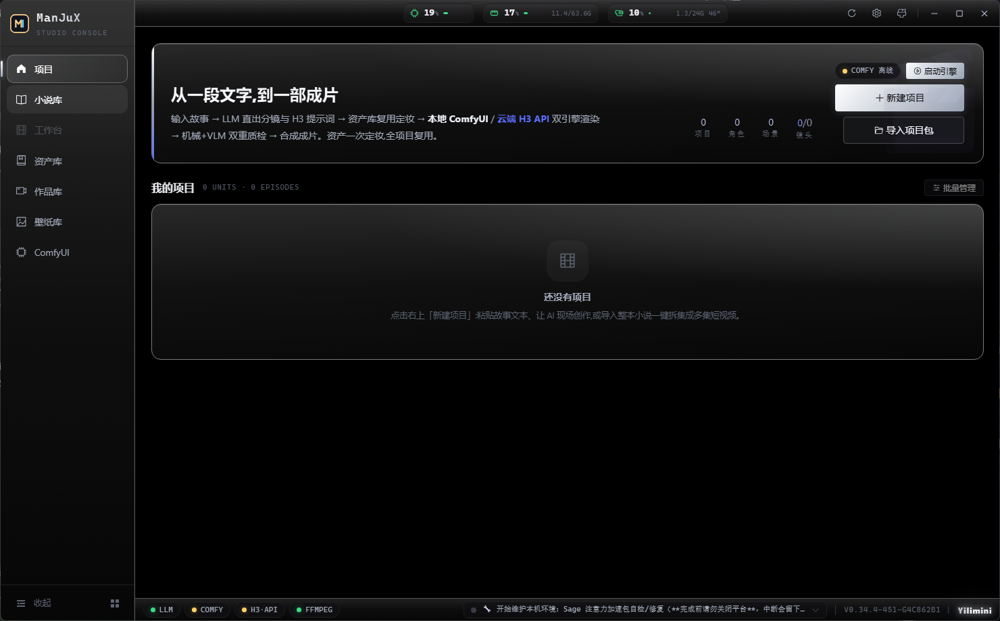
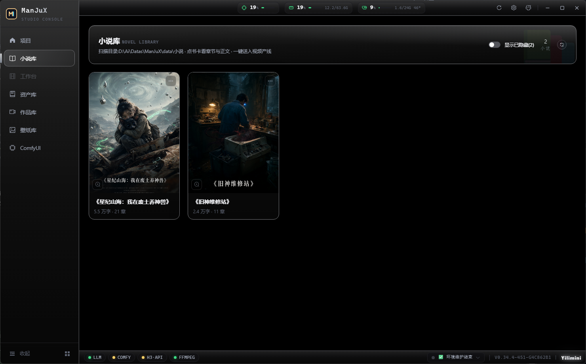
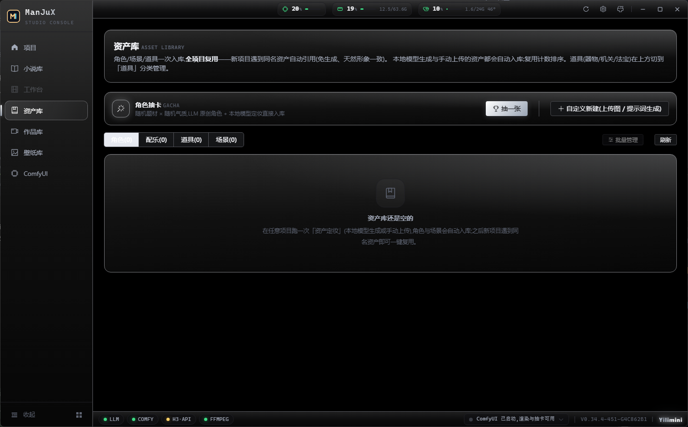
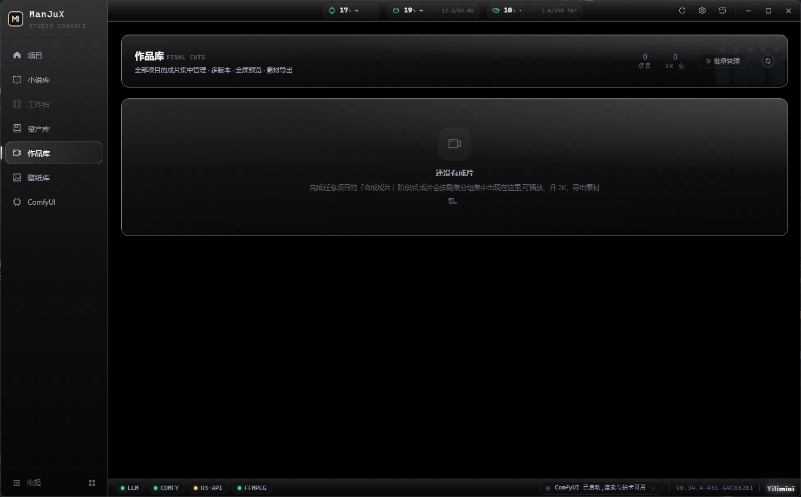
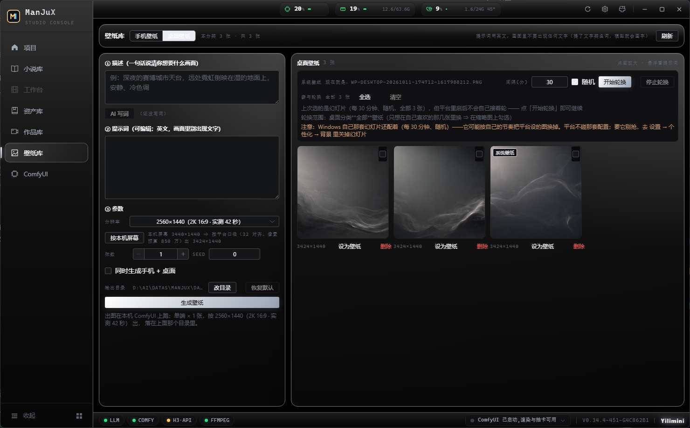
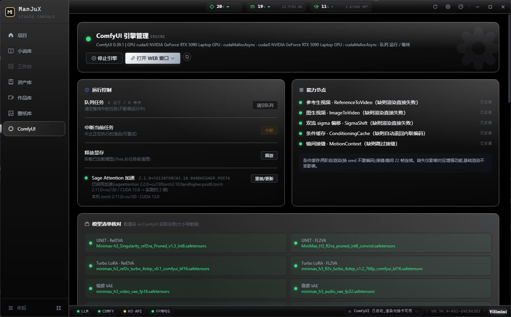
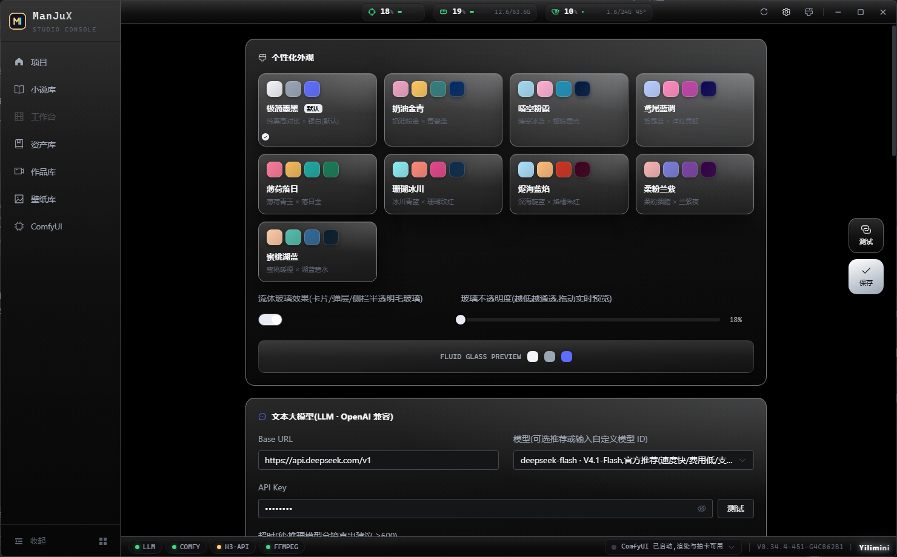

# ManJuX · 短视频创作工作台

> 从一段文字，到一部成片 —— 桌面级 AI 短视频生产线。
> 技术栈：Go（Wails v2 桌面框架）+ Vue 3 + Element Plus + Tailwind。


写一段故事、或者直接导入一本小说，平台把它跑成成片：
**LLM 直出分镜与 H3 提示词 → 资产定妆（角色/场景/道具入库复用）→ 双引擎渲染（本地 ComfyUI H3 / 云端 MiniMax-H3）→ 机械 + VLM 双重质检 → 合成成片（字幕/响度/2K 定稿）**。
五阶段可独立运行、独立调参（项目级参数快照），支持断点续跑与单镜重渲。

## 界面

| 项目 —— 一键全流程入口，跨项目统计 | 小说库 —— 目录导入、封面、一键拆集 | 资产库 —— 角色/场景一次定妆，全局复用 |
|---|---|---|
|  |  |  |

| 作品库 —— 成片集中管理、多版本、导出素材包 | 壁纸库 —— 生成与轮换，手机 / 桌面两分类 | ComfyUI 引擎管理 —— 队列、显存、Sage 加速、模型核对 |
|---|---|---|
|  |  |  |

| 个性化外观 —— 9 套主题 + 流体玻璃；LLM 连接可一键测试 |
|---|
|  |

> 截图取自本机实际运行（1480×920 窗口）。所有图都在 [`docs/shots/`](docs/shots/)。

## 它能做什么

| 阶段 | 能力 |
|---|---|
| **剧本分镜** | LLM 直出角色卡 / 场景卡 / 分镜表 + 每镜完整 H3 提示词（Ref2VA 六段式 / T2VA 三段式，对白原生配音）；镜数由内容决定、不设上限；思考型模型兼容（JSON mode 自动降级） |
| **资产定妆** | Krea-2 自动生成（角色半身 / 场景按画幅，约 10 秒一张）/ 手动上传 / 跳过三级策略；已有资产自动复用；角色自动补多视角转台图（渲染时作第二张参考） |
| **渲染出片** | 双引擎：本地 ComfyUI（768p、Turbo LoRA、两阶段条件缓存）/ 云端 MiniMax-H3（768P / 2K）；auto 本地优先；镜头级引擎分派；单镜失败不中断整批；镜头级增强（局部重绘 / 音频驱动重渲） |
| **质检** | 时长 / 音轨 / 分辨率探测 + 抽帧亮度与黑场体检（黑屏防线）+ VLM 智能审片（内容级防线，可给重渲建议）；过程不阻断合成 |
| **合成成片** | 重编码拼接（硬切 / 闪黑 / 叠化 xfade）+ ASS 字幕（画幅自适应）+ loudnorm 响度 + faststart；云端 2K 定稿一键或自动 |

**桌面体验**：Wails 原生窗口（单实例）、渲染中关窗二次确认、实时 SSE 日志流（可拖动悬浮窗）、设置页一键测试连接（LLM / ComfyUI / MiniMax / VLM）。

**生产线与一致性**：整本小说拆集批量产线（一章一集，集名取章标题原文）；系列角色 roster 跨集注入，配合资产库同名复用与锚定种子不换脸；同一时刻只跑一条管线，排队不吃执行预算。

**引擎治理**：ComfyUI 代管启停（全进程树、零残留）、空闲释放显存、代管 PID 持久化、渲染前节点预检、Sage Attention 加速（实测同镜 ≈ 2×）、模型清单与版本在线核对。

**质量防线**：台词语言锁定（`<d>[Chinese]` 五处统一补齐）、风格与身份分离（风格块不含形状词、脸必须与角色卡一致）、角色按实体类型分派渲染方法（人 / 物 / 灵宠 / 妖兽 / 无实体 / Q 版）、黑闪自动切除（≤0.6 秒）与成片体检。

> 逐版本的能力演进（v0.4 → v0.37.1，含真机实测数字）已抽到独立文档：
> [`docs/版本亮点-v0.4到v0.37.md`](docs/版本亮点-v0.4到v0.37.md)。

## 快速开始

1. **双击 `ManJuX.exe`** —— 弹出桌面工作台窗口（单实例，重复启动自动唤起已有窗口）。
2. **设置**（右上角）：填写 LLM（OpenAI 兼容，推荐 DeepSeek）与 MiniMax API Key；本地 ComfyUI 路径默认适配仓库同级的 `comfyui/`。
3. **新建项目** → 剧本页粘贴故事文本 → 「一键全流程」，或逐阶段运行。
4. 渲染与合成进度在底部 **RUNTIME LOG** 实时滚动；分镜故事板逐镜点亮；成片页预览 / 导出。

## 目录规范（严谨，不乱放）

仓库里只放**源码与文档**；`comfyui/`、`data/`、构建产物都在 `.gitignore` 里，第一次跑起来会自动生成。

```
ManJuX/
├── main.go                 # Wails 桌面入口
├── internal/               # Go 模块（分模块划分见 docs/架构.md）
├── frontend/               # Vue3 前端源码（src/）
├── build/                  # wails 图标与构建资源
├── scripts/                # check.ps1（八门自检）/ build.ps1 / release.ps1
├── third_party/            # 就地打过补丁的 go-webview2（含 MIT / ISC 许可原文）
├── docs/                   # 文档：主题过程记录 + 使用手册 / 架构 / CHANGELOG / 契约门总表
│   └── shots/              # README 用的界面截图
├── ManJuX.exe              # 交付用桌面应用（构建产物，不入库）
├── comfyui/                # 本地 ComfyUI 完整环境（含模型与 Python，约 134G，不入库）
└── data/                   # 运行数据（不入库）
    ├── settings.json       # 全局设置（API Key 等）
    ├── logs/               # 应用日志 manjux.log / comfyui.log
    ├── cond_cache/         # H3 条件缓存记账
    └── projects/<项目>/
        ├── project.json    # 项目元数据 + 阶段参数（独立调优）
        ├── source.txt      # 源文本
        ├── plan/plan.json  # LLM 直出分镜方案
        ├── assets/         # characters/scenes/props + asset_map.json
        ├── clips/          # 镜头产物 NN.mp4 + manifest.json（断点/时效）
        └── output/         # final.mp4 / final.srt / qc_report.json
```

## 构建与发布

```powershell
# 提交前自检：八门一次跑完（gofmt / go vet / go build / go test / go test -race /
# 前端 vite 构建 / go-webview2 补丁在位 / 脚本文本编码含 BOM）
# 改了 frontend/src 必跑 —— 不重建 webdist 等于界面改动没生效
powershell -ExecutionPolicy Bypass -File scripts\check.ps1

# 日常构建（前端 + 桌面 exe）
powershell -ExecutionPolicy Bypass -File scripts\build.ps1

# 发布（构建 → commit → tag → 推送；版本号 / tag 由人拍板）
powershell -ExecutionPolicy Bypass -File scripts\release.ps1 -Note "说明"
```

依赖：Go 1.25+、Wails CLI（`go install github.com/wailsapp/wails/v2/cmd/wails@latest`）、Node + pnpm、ffmpeg（PATH）。

## 环境要求

- **本地渲染**：ComfyUI（完整环境自带 MiniMax-H3 int8 模型；应用可代管启动）。没有本地引擎时可只用云端。
- **云端渲染**：MiniMax 开放平台 API Key（[platform.minimaxi.com](https://platform.minimaxi.com)）。
- **剧本生成**：任意 OpenAI 兼容 LLM（DeepSeek / GLM / Qwen / Kimi / 本地 vLLM 均可）。
- **显存**：本地 768p 渲染按 H3 int8 权重 + Turbo LoRA 估算，24G 级显卡可跑；实测机型 RTX 5090 Laptop。

## 文档导航

| 文档 | 内容 |
|---|---|
| [`docs/使用手册.md`](docs/使用手册.md) | 界面操作、阶段调优、常见问题 |
| [`docs/架构.md`](docs/架构.md) | 模块划分、引擎抽象、管线编排 |
| [`docs/版本亮点-v0.4到v0.37.md`](docs/版本亮点-v0.4到v0.37.md) | 逐版本能力清单（从 README 抽出） |
| [`docs/CHANGELOG.md`](docs/CHANGELOG.md) | 逐条改动记录（含真机取证、门与反向验证） |
| [`docs/COMPATIBILITY.md`](docs/COMPATIBILITY.md) | 与官方 ComfyUI / H3 节点的兼容口径 |
| [`docs/门目录.md`](docs/门目录.md) | 契约门总表（由 `tools/gatecat` 生成，勿手改） |
| [`docs/归档/`](docs/归档) | 历史快照（例如公开整理前的 README 全文） |

> `docs/` 下还有 90+ 份按主题与日期命名的过程文档（排查记录、口径对账、整改单、审计报告）——
> 它们记录的是"当时为什么这么改"，按文件名检索即可。README 只保留长期有效的信息。
